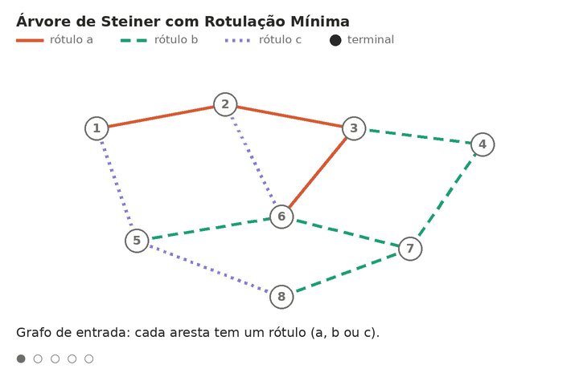

## MLSteiner: Árvore de Steiner com Rotulação Mínima

Implementação em Python de uma heurística para o problema da **Árvore de Steiner com Rotulação Mínima** (*Minimum Labeling Steiner Tree*, MLSteiner).

**O problema:** dado um grafo em que cada aresta tem um rótulo (cor) e um
conjunto de vértices básicos, encontrar uma árvore que conecte todos os
vértices básicos usando o menor número possível de rótulos diferentes.

<p align="center">
  
</p>

## Como rodar o projeto

### 1. Clonar o repositório

```bash
git clone <URL-DO-REPOSITORIO>
cd <NOME-DA-PASTA>
```

### 2. Gerar uma instância e resolver

```bash
python3 gerador.py 100 125 0.2 40 --seed 7 -o exemplo.txt
python3 guloso.py exemplo.txt
python3 heuristica.py exemplo.txt
python3 pilot.py exemplo.txt
```

### 3. Reproduzir as tabelas do artigo

```bash
python3 gerador.py --banco instancias/     # gera as 720 instâncias
python3 experimentos.py 50
python3 experimentos.py 100
python3 experimentos.py 500 --sem-pilot
Scripts em Python puro (só biblioteca padrão, Python 3.8 ou superior) para gerar
instâncias e resolver o problema da Árvore de Steiner com Rotulação Mínima.
Deixe todos os arquivos na mesma pasta: alguns scripts importam funções dos
outros.

| Arquivo | O que faz |
|---|---|
| `gerador.py` | Gera instâncias aleatórias do problema |
| `guloso.py` | Algoritmo guloso de Cerulli et al. (2006) |
| `heuristica.py` | Heurística MVCA-Steiner (proposta no trabalho) |
| `pilot.py` | Pilot Method de Cerulli et al. (2006) |
| `experimentos.py` | Roda os três métodos em todas as instâncias de um tamanho e imprime as tabelas do artigo |

---
## Formato da instância

Arquivo de texto:

```
n m l q              <- nº de vértices, arestas, rótulos e vértices básicos
b1 b2 ... bq         <- os vértices básicos (numerados de 0 a n-1)
u v c                <- uma aresta por linha: liga u a v, com rótulo c
...
```

---

## `gerador.py`

Gera instâncias aleatórias. Primeiro cria uma árvore aleatória, para o grafo
ser conexo, e depois sorteia as demais arestas até completar
`m = d·n(n−1)/2`. Cada aresta recebe um rótulo aleatório, e os `q` vértices
básicos são sorteados.

**CLI**

```
python3 gerador.py N L D Q [--seed S] [-o ARQUIVO]
python3 gerador.py --banco PASTA
```

| Argumento | Significado |
|---|---|
| `N` | número de vértices |
| `L` | número de rótulos |
| `D` | densidade, entre 0 e 1 |
| `Q` | número de vértices básicos |
| `--seed S` | semente aleatória (padrão: 0); a mesma semente gera a mesma instância |
| `-o ARQUIVO` | arquivo de saída (padrão: `instancia.txt`) |
| `--banco PASTA` | gera o banco completo do artigo (720 instâncias) na pasta indicada |

**Exemplos**

```
python3 gerador.py 100 125 0.2 40 --seed 7 -o exemplo.txt
python3 gerador.py --banco instancias/
```

O banco usa n ∈ {50, 100, 500}, l ∈ {0,25n; 0,5n; n; 1,25n},
d ∈ {0,8; 0,5; 0,2} e q ∈ {0,2n; 0,4n}, com 10 instâncias por combinação.

---

## `guloso.py`

Algoritmo guloso original de Cerulli et al. (2006). Começa sem nenhum rótulo e,
a cada passo, adiciona o rótulo que deixa menos componentes contendo vértices
básicos, até todos ficarem conectados. Empates são decididos pelo menor número
do rótulo. No final, remove rótulos que ficaram desnecessários.

Este arquivo também contém as funções usadas pelos outros scripts: union-find,
teste de viabilidade, extração e verificação da árvore.

**CLI**

```
python3 guloso.py ARQUIVO
```

**Exemplo**

```
$ python3 guloso.py exemplo.txt
Guloso (Cerulli et al., 2006): 10 rótulos [1, 15, 16, 31, 37, 47, 62, 85, 106, 120]  (11.4 ms)
árvore verificada: 62 arestas, 10 rótulos distintos
```

---

## `heuristica.py`

Heurística MVCA-Steiner: o guloso acima com duas melhorias.

1. **Desempate:** entre rótulos empatados, prefere o que "puxa" mais partes sem
   vértices básicos para dentro das partes com básicos e, depois, o que faz
   mais ligações.
2. **Eliminação:** no final, tenta remover cada rótulo, do menos para o mais
   frequente, sem desconectar os básicos.

**CLI**

```
python3 heuristica.py ARQUIVO [--sem-eliminacao]
```

| Opção | Significado |
|---|---|
| `--sem-eliminacao` | desliga a etapa 2 (coluna "s/elim." das tabelas) |

**Exemplo**

```
$ python3 heuristica.py exemplo.txt
MVCA-Steiner: 9 rótulos [1, 31, 37, 47, 70, 85, 87, 106, 116]  (10.9 ms)
árvore verificada: 56 arestas, 9 rótulos distintos
```

---

## `pilot.py`

Pilot Method de Cerulli et al. (2006). Monta a solução rótulo a rótulo: em cada
etapa, testa cada rótulo candidato completando a solução com o guloso e fica
com o que levou à menor solução. Encontra soluções melhores, mas é bem mais
lento, pois executa o guloso muitas vezes.

**CLI**

```
python3 pilot.py ARQUIVO
```

**Exemplo**

```
$ python3 pilot.py exemplo.txt
Pilot Method: 8 rótulos [1, 7, 31, 37, 47, 85, 103, 116]  (7346.8 ms)
árvore verificada: 56 arestas, 8 rótulos distintos
```

---

## `experimentos.py`

Roda os métodos em todas as instâncias de um tamanho `n` e imprime a média de
rótulos por classe, no formato das Tabelas 1 a 3 do artigo. Se as instâncias
ainda não existirem, ele as gera na pasta `instancias/`.

**CLI**

```
python3 experimentos.py N [--sem-pilot]
```

| Argumento | Significado |
|---|---|
| `N` | tamanho das instâncias: 50, 100 ou 500 |
| `--sem-pilot` | não roda o Pilot Method (recomendado para N = 500, que levaria horas) |

**Exemplo**

```
$ python3 experimentos.py 50
   q    l    d | MVCA-S  Cer. s/elim Pilot |     ms
  10   12  0.8 |    1.0   1.0    1.0   1.0 |    1.2
  ...
          soma |   40.0  40.5   40.6  38.0 |
```

**Colunas da saída**

| Coluna | Significado |
|---|---|
| `q`, `l`, `d` | parâmetros da classe |
| `MVCA-S` | média de rótulos da heurística proposta |
| `Cer.` | média de rótulos do guloso original |
| `s/elim` | média da heurística sem a eliminação |
| `Pilot` | média do Pilot Method |
| `ms` | tempo médio da heurística, em milissegundos |

Quanto menor o número de rótulos, melhor. A coluna OPT (ótimo) do artigo vem
de um solver exato externo e não é calculada por estes scripts.

---

## Usando como biblioteca

```python
from gerador import ler
from heuristica import mvca_steiner
from guloso import arestas_por_rotulo, extrair_arvore

n, l, arestas, basicos = ler("exemplo.txt")
C = mvca_steiner(n, l, arestas, basicos)          # conjunto de rótulos
T = extrair_arvore(n, arestas_por_rotulo(l, arestas), basicos, C)
print(len(C), "rótulos;", len(T), "arestas na árvore")
```


Cada aresta é `[u, v, rótulo]`. Os vértices são inferidos a partir das arestas.

## Integrantes
Victor Bastos Xavier - victor.xavier.702@ufrn.edu.br

Raul Ramalho Lucena - raulramalho2016@gmail.com 

## Referências (Papers) - AINDA NÃO IMPLEMENTADO